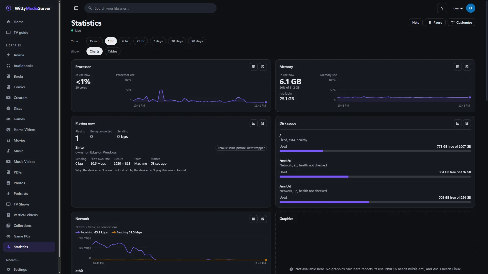

# WittyStats

A statistics screen for WittyMediaServer that you arrange yourself: the machine, who is playing what, your libraries and their history, as charts or tables. You need it if you want to see those numbers on a page of their own.

It's the screen only. The server collects the numbers and decides who may see what, with or without this module.

<!-- pictures -->



<sub>From a test server.</sub>

<!-- /pictures -->

## What it does

| Group | Widgets |
|---|---|
| **Machine** | Processor, processor cores, temperature, memory, swap, graphics and encoder sessions, disk space, disk speed and how busy, network per connection |
| **This server** | The program itself (processor, memory, heap, goroutines, threads, handles, memory clean-ups), uptime, modules and updates, background work, database, caches, warnings and errors |
| **Playing now** | Who is playing what on which device, whether it's direct, remuxed or transcoded and why, its rate, picture size and where it's from; how much converting is going on; game sessions with frame rate and encoding time |
| **Libraries** | Items and sizes by library and type, video formats, picture sizes, duplicates and possible savings, scan times |
| **History** | Most watched, data by person, the busiest moment, playing over time |

- **What a server can't provide says why.** The server's catalogue says what's available here, and a widget that can't show anything says "Not available here" with the reason. It's never drawn as a zero.
- **Estimates say they are.** Duplicates and possible savings carry an Estimate mark, on the card, in the table and in the export.
- **Encoding time is labelled** as the server's part of a game's delay. The network's part is known only to the player.
- **Someone who isn't an administrator** sees only what the server allows them: their own streams and game sessions, the libraries they can see, what they've watched. There's no empty frame for the rest, and every preset still works. If the owner hasn't let them look at all, it says so plainly.

Every widget has a **switch to a table**, and one switch does them all. Tables are real tables, with captions and headings. Charts have a summary in words as their name, and nothing depends on colour alone: line ends have different shapes, legends and values sit beside the marks, and warnings have an icon and a word.

**Details** opens any widget to more series and every row, with **CSV and JSON** of what's shown. The files are made in the browser from what it already holds. A CSV cell that a spreadsheet would run as a formula gets a quote in front of it, as a title on a media server is anyone's to choose. Numbers stay raw with their unit in the heading, and times are ISO dates.

**Layouts.** Choose **Customise** to move, resize and remove widgets, with buttons or by dragging, and **Undo** to go back. You can keep up to eight layouts. The presets are Simple, Standard and Advanced, and they replace what's on the layout on screen. **Reset to stock** asks first. Layouts are saved per person.

**What it costs.** Nothing until the page opens. Then one stream, asking only for what's on the layout and only while the page is showing. The report and histories are fetched when a widget that needs them is near the screen, no more than once a minute. There's no polling for live numbers and no chart library.

How to use it is in **Help** inside WittyMediaServer: see Server statistics.

## How to get it

An admin adds it from the module store inside WittyMediaServer: **Settings → Modules**, then **Browse the store**, then **Add** beside WittyStats. That needs WittyMediaServer 0.6.0-alpha or later, and it works with nothing older. The range this version fits is in `module.json`: 0.6.0-alpha through 0.6.x.

The page appears as **Statistics** in the main menu.

## What it needs

WittyMediaServer's numbers, and React 18 or newer, which the app provides. It has no other dependencies.

## Platforms

It's one browser bundle for every system the server runs on, and it runs on whichever device opens the server. It has been seen working in a desktop browser, against a test server on Linux. Safari, real phones and real TVs have not been tried.

Not seen yet: a real TV, a controller, a screen reader, touch dragging, a live game session, sensors, and duplicates, bandwidth and most watched with real rows. It's built for phones (one column), TV and controller (arrows reach everything), keyboard, and reduced motion.

## Building and testing

You need Node.js 22, as CI uses, and Go for the manifest check. In a worktree, first run the copy of `dev-modules.mjs` kept above the repositories (`node D:/projects/dev-modules.mjs` on the development machine). It writes only links that git ignores, so the checkout builds against the repositories beside it.

```bash
npm install
```

```bash
npm run build:bundle
```

That makes one script and one stylesheet, as a server installs them. To check the manifest:

```bash
go run github.com/wittywilla/wittymodule/cmd/wittymodule check .
```

```bash
npm test
```

The tests cover layouts, stored data, every widget's view, CSV, number formats and reading the stream.

A page gets one prop, `host`, and needs nothing else from the app: `request` for the server's API, `user`, a small `store` per account, and optionally `token` and `base` for the stream.

```
src/widgets.ts    every widget: what it needs and what can have it; the presets
src/layout.ts     layouts as plain data: add, move, resize, presets, reading what's stored
src/views.ts      what each widget shows, as plain data: chart, table, words and exports all come from this
src/store.ts      what's been received, and the rules for how little to ask for
src/frames.ts     reads server-sent events by fetch
src/exports.ts    CSV and JSON
src/format.ts     numbers for people
src/charts.tsx    the charts and tables
src/Widget.tsx, StatsPage.tsx, Detail.tsx, Customise.tsx, parts.tsx, stats.css    the screen
```

## Licence

Apache-2.0: see [LICENSE](LICENSE) and [NOTICE](NOTICE). If you redistribute it or build on it, keep the NOTICE attribution.

## Legal

WittyStats is an independent open-source project. It isn't associated with, sponsored by or endorsed by any maker of operating
systems, graphics cards or other media software whose numbers it may show. It holds no media and sends nothing anywhere: everything it
shows comes from your own server. Figures marked as estimates are only that, so check before acting on them. Any third-party names
here only describe what it works with, and belong to their owners. It's provided “as is”, with no warranty; see [LICENSE](LICENSE).
Local law applies to how you use it. This isn't legal advice.

<!-- module-kit -->
## Releasing

A version tag builds the bundle for the browser, signs the checksum list, and publishes a release that servers can install.

Versions move in small steps as work lands. `go run github.com/wittywilla/wittymodule/cmd/wittymodule@v0.3.0 bump .` raises it
everywhere it is written (add `-part minor` for a bigger step). A bump isn't a release: nothing is
tagged or published until you tag it. CI fails when code changed since the last tag and the version
didn't, because tags never move.

To release:

1. Check that `version` in `module.json` is the one to publish, with the bump committed.
2. Tag that commit and push the tag: `git tag vX.Y.Z`, then `git push origin vX.Y.Z`. A tag with a
   suffix, such as `v1.2.0-beta`, is published as a prerelease.
3. Watch the *Actions* tab. The signing step uses the `WMS_SIGNING_KEY` secret of the `release` environment, and nothing is published without it.

To take a version back, run the *withdraw* workflow from the *Actions* tab. It adds the version to a signed list on the release tagged `withdrawals`, which servers read.

Licensed under Apache-2.0: see [LICENSE](LICENSE) and [NOTICE](NOTICE).
<!-- /module-kit -->
